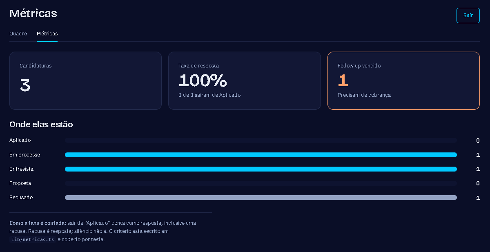

# Rastreador de candidaturas


Quem está procurando vaga perde o fio: não lembra onde aplicou, quem
respondeu, nem quando cobrar retorno. Este app resolve isso num quadro
estilo Kanban, com cada pessoa vendo apenas as próprias candidaturas.

**[Abrir o app](https://rastreador-candidaturas.vercel.app)** — crie uma
conta com qualquer e-mail e senha; o acesso é imediato, sem confirmação
por e-mail.




## O que ele faz

- Login por e-mail e senha, com isolamento garantido no banco
- Cadastro com empresa, cargo, link da vaga, data, status e observações
- Quadro Kanban com as cinco etapas, arrastando o card entre elas, ou
  pelo seletor "Mover para" de cada card — arrastar não é o único
  caminho, o que importa no celular e para quem usa teclado
- Edição de uma candidatura já cadastrada, sem precisar apagar e
  refazer
- Destaque visual para o follow up que já venceu, e uma chamada no topo
  dizendo o que precisa ser cobrado hoje
- Tela de métricas: total, taxa de resposta e quantas em cada etapa

## Stack

| | |
|---|---|
| Framework | Next.js 16 (App Router) |
| Linguagem | TypeScript |
| Banco e login | Supabase (Postgres + Auth + RLS) |
| Arrastar e soltar | dnd-kit |
| Testes | Vitest |
| CI | GitHub Actions |
| Deploy | Vercel |

## Rodando

```bash
npm install
cp .env.example .env.local   # preencha com os dados do seu Supabase
npm run dev                  # localhost:3000
npm test                     # 51 testes das regras, métricas, validação e datas
```

## Duas decisões técnicas

### 1. O isolamento entre usuários fica no banco, não na tela

O filtro por usuário poderia ficar só no front-end. Mas o front roda na
máquina da outra pessoa, e qualquer um pode chamar a API do Supabase
diretamente, fora do app.

Por isso a tabela usa **Row Level Security**: quatro políticas que
comparam `auth.uid()` com a coluna `usuario_id`. A consulta do painel é
literalmente `select("*")`, sem nenhum filtro por usuário — quem filtra é
o banco.

Parece arriscado e é o contrário: filtrar também no código criaria dois
lugares onde dá para esquecer. Com RLS, esquecer não é uma opção. Se a
política cair, a tabela deixa de devolver qualquer linha em vez de
devolver todas; a falha é para o lado seguro.

Verificado na prática com duas contas distintas no app publicado: a
segunda conta não enxergou nenhuma linha da primeira.

### 2. As regras de negócio não conhecem o React

As transições de status, o cálculo das métricas, a validação do
formulário e as contas de data ficam em `lib/`, em arquivos sem nenhum
import de React. São funções puras: recebem dados, devolvem dados, não
olham relógio nem consultam banco.

Três consequências práticas:

- `estaAtrasado(followUp, hoje, status)` recebe a data de hoje como
  parâmetro. Se chamasse `new Date()` por dentro, o resultado mudaria a
  cada execução e o teste não teria o que afirmar.
- A mesma função que valida o formulário no servidor é a que os testes
  exercitam. O `required` do campo é conveniência: ele sai do HTML em
  dois cliques no DevTools, então a palavra final é do servidor.
- A suíte roda em menos de um segundo, sem navegador. É isso que torna
  viável rodar os 51 testes a cada push no CI.

O limite honesto: esses testes cobrem as regras, não a fiação. Que a
tela chama a action certa e que a RLS está ligada em produção foi
verificado à mão, não por teste automatizado.

## No celular

As colunas empilham abaixo de 940px e o formulário abaixo de 640px.
Mas responsivo não basta para um quadro Kanban: com uma coluna por
tela, levar um card de "Aplicado" até "Proposta" com o dedo
atravessaria várias telas de rolagem.

Por isso cada card tem um seletor **Mover para**, que lista apenas os
destinos que a regra aceita — um card em "recusado" não mostra
seletor nenhum. É a mesma função `podeMover` que governa o arrasto,
dita de outro jeito.

O mesmo seletor resolve o caso de quem navega por teclado ou leitor
de tela, onde arrastar também é um gesto ruim.

## Os testes

São 51, rodam em menos de um segundo e não sobem banco nem navegador.
Isso é possível porque o que eles testam são funções puras: recebem
dados, devolvem dados, não olham relógio nem consultam nada.

| Arquivo | Testes | O que garante |
|---|---|---|
| `lib/status.test.ts` | 16 | Quais transições o quadro aceita, e que "recusado" é ponto final. Que o follow up vencido é detectado, e que uma candidatura encerrada não é cobrada. |
| `lib/validacao.test.ts` | 17 | Que o formulário recusa data que não existe no calendário, follow up anterior à candidatura, status inventado e texto além do limite. Que o link ganha `https://` quando falta. |
| `lib/metricas.test.ts` | 7 | O total, a contagem por etapa e a taxa de resposta — inclusive que lista vazia devolve 0% em vez de `NaN%`. |
| `lib/data.test.ts` | 11 | Diferença de dias, formatação, e que "hoje" é o dia em Brasília, não no fuso do servidor. |

Alguns casos que valem olhar, porque são os que quebram em produção e
não em desenvolvimento:

- `2026-02-31` passa num teste de formato e não existe no calendário.
- `2028-02-29` existe; `2027-02-29` não.
- Lista vazia na taxa de resposta: `0/0` é `NaN`, e a primeira tela de
  quem acabou de criar a conta mostraria "NaN%".
- Diferença de dias em fuso local erra por um nos dias de mudança de
  horário, quando o dia tem 23 ou 25 horas.

```bash
npm test          # roda uma vez
npm run test:watch  # roda a cada alteração
```

O GitHub Actions executa `npm ci` e `npm test` a cada push, numa
máquina limpa. É isso que o badge no topo está afirmando.

### O que os testes não cobrem

Eles cobrem as regras, não a fiação. Nenhum teste garante que a tela
chama a ação certa, que o arrastar grava no banco, ou que a RLS está
mesmo ligada em produção. Isso pediria teste de ponta a ponta, que
este projeto não tem.

Essas três coisas foram verificadas à mão: a RLS com duas contas
distintas no app publicado, onde a segunda não enxergou nenhuma linha
da primeira; e o arrastar e o cadastro abrindo a tela e usando.

Dois defeitos reais apareceram nessa verificação manual e nenhum dos
51 testes teria pegado, porque nenhum dos dois é regra de negócio: o
formulário apagava tudo o que tinha sido digitado quando a validação
recusava, e a coluna vazia não mostrava onde soltar o card.

## Estrutura

```
app/
  entrar/         login e cadastro (server actions)
  painel/         quadro Kanban, cadastro e campos do formulário
  candidatura/    edição de uma candidatura já criada
  metricas/       números e funil por etapa
lib/
  tipos.ts        os cinco status e o formato de uma candidatura
  status.ts       regras de transição e de follow-up atrasado
  metricas.ts     total, taxa de resposta e contagem por etapa
  validacao.ts    validação do formulário, independente de framework
  data.ts         fuso de Brasília, diferença de dias, formatação
  supabase/       clientes de navegador, de servidor e o middleware
  *.test.ts       51 testes
middleware.ts     revalida a sessão e protege as rotas
.github/workflows/testes.yml
```

## Como este projeto foi construído

Usei IA como par de programação, e está registrado nos commits — por
isso o Claude aparece como contribuidor. Trabalhei com a regra de não
aceitar nada que eu não soubesse explicar.

As duas decisões acima são as principais, mas qualquer parte do código
eu consigo justificar: por que a consulta do painel não filtra por
usuário, por que `getUser()` e não `getSession()`, por que
`estaAtrasado` recebe a data como parâmetro em vez de olhar o relógio,
e por que o CI quebrou no `npm ci` e como eu achei.

---

Projeto da mentoria DevVagas, por [Ravena Leite](https://www.linkedin.com/in/ravena-leite-3a5804399/).
