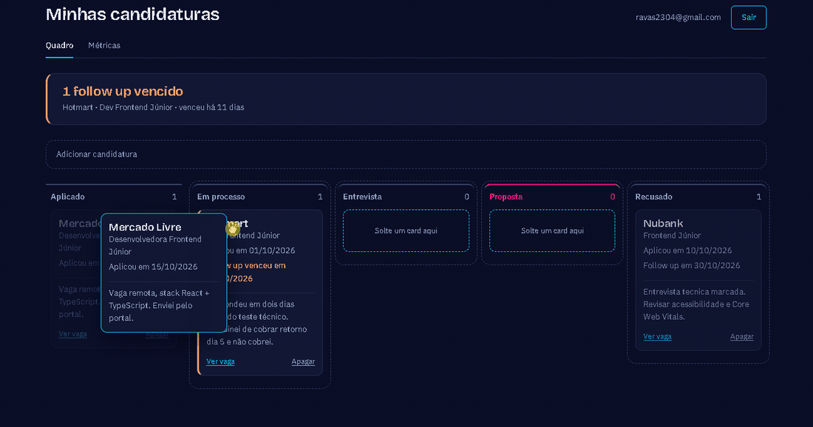

# Rastreador de candidaturas


Quem está procurando vaga perde o fio: não lembra onde aplicou, quem
respondeu, nem quando cobrar retorno. Este app resolve isso num quadro
estilo Kanban, com cada pessoa vendo apenas as próprias candidaturas.

**[Abrir o app](https://rastreador-candidaturas.vercel.app)** — crie uma
conta com qualquer e-mail e senha; o acesso é imediato, sem confirmação
por e-mail.



## O que ele faz

- Login por e-mail e senha, com isolamento garantido no banco
- Cadastro com empresa, cargo, link da vaga, data, status e observações
- Quadro Kanban com as cinco etapas, arrastando o card entre elas
- Destaque visual para o follow up que já venceu, e uma chamada no topo
  dizendo o que precisa ser cobrado hoje
- Tela de métricas: total, taxa de resposta e quantas em cada etapa

## Stack

| | |
|---|---|
| Framework | Next.js 16 (App Router) |
| Linguagem | TypeScript |
| Banco e login | Supabase (Postgres + Auth + RLS) |
| Arrastar e soltar | dnd-kit |
| Testes | Vitest |
| CI | GitHub Actions |
| Deploy | Vercel |

## Rodando

```bash
npm install
cp .env.example .env.local   # preencha com os dados do seu Supabase
npm run dev                  # localhost:3000
npm test                     # 51 testes das regras, métricas, validação e datas
```

## Duas decisões técnicas

### 1. O isolamento entre usuários fica no banco, não na tela

O filtro por usuário poderia ficar só no front-end. Mas o front roda na
máquina da outra pessoa, e qualquer um pode chamar a API do Supabase
diretamente, fora do app.

Por isso a tabela usa **Row Level Security**: quatro políticas que
comparam `auth.uid()` com a coluna `usuario_id`. A consulta do painel é
literalmente `select("*")`, sem nenhum filtro por usuário — quem filtra é
o banco.

Parece arriscado e é o contrário: filtrar também no código criaria dois
lugares onde dá para esquecer. Com RLS, esquecer não é uma opção. Se a
política cair, a tabela deixa de devolver qualquer linha em vez de
devolver todas; a falha é para o lado seguro.

Verificado na prática com duas contas distintas no app publicado: a
segunda conta não enxergou nenhuma linha da primeira.

### 2. As regras de negócio não conhecem o React

As transições de status, o cálculo das métricas, a validação do
formulário e as contas de data ficam em `lib/`, em arquivos sem nenhum
import de React. São funções puras: recebem dados, devolvem dados, não
olham relógio nem consultam banco.

Três consequências práticas:

- `estaAtrasado(followUp, hoje, status)` recebe a data de hoje como
  parâmetro. Se chamasse `new Date()` por dentro, o resultado mudaria a
  cada execução e o teste não teria o que afirmar.
- A mesma função que valida o formulário no servidor é a que os testes
  exercitam. O `required` do campo é conveniência: ele sai do HTML em
  dois cliques no DevTools, então a palavra final é do servidor.
- A suíte roda em menos de um segundo, sem navegador. É isso que torna
  viável rodar os 51 testes a cada push no CI.

O limite honesto: esses testes cobrem as regras, não a fiação. Que a
tela chama a action certa e que a RLS está ligada em produção foi
verificado à mão, não por teste automatizado.

## Estrutura

```
app/
  entrar/         login e cadastro (server actions)
  painel/         quadro Kanban e cadastro de candidatura
  metricas/       números e funil por etapa
lib/
  tipos.ts        os cinco status e o formato de uma candidatura
  status.ts       regras de transição e de follow-up atrasado
  metricas.ts     total, taxa de resposta e contagem por etapa
  validacao.ts    validação do formulário, independente de framework
  data.ts         fuso de Brasília, diferença de dias, formatação
  supabase/       clientes de navegador, de servidor e o middleware
  *.test.ts       51 testes
middleware.ts     revalida a sessão e protege as rotas
.github/workflows/testes.yml
```

---

Projeto da mentoria DevVagas, por [Ravena Leite](https://www.linkedin.com/in/ravena-leite-3a5804399/).
